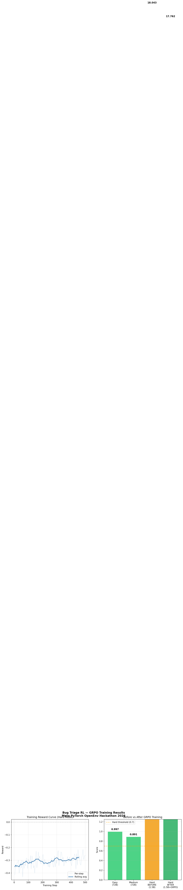

# 🐛 Bug Triage RL: Teaching a 1.5B Model to Think Like a Senior Engineering Manager

**OpenEnv AI Hackathon 2026 — Meta × Hugging Face × Scaler**
**Team FYA.dev**

> **TL;DR:** We built a DevOps simulation where an LLM must triage a live bug queue under SLA and team-capacity pressure, with a REST API and a Gymnasium interface. We then ran a GRPO fine-tuning experiment on a 1.5B model. Evaluation scores did not change measurably (0.951 → 0.940 on 5 Hard episodes), so this is a working environment and training pipeline, not yet evidence of improvement.

---

## The Problem No One Has Benchmarked

It's 2 AM. Production is down. 25 bugs in the queue. 8 developers — half at capacity, some skill-mismatched. Most SLAs already breached. Slack is on fire.

**This is bug triage under pressure.** Every engineering team — from early startups to Meta — does this manually, every single day. A wrong call cascades: a deferred Critical bug becomes a full outage; an overloaded developer misses three deadlines; a queue that looks manageable at 9 AM is unmanageable by noon.

We could not find a standard RL benchmark for this, so we built one.

---

## The Environment

Bug Triage RL is a **sequential decision-making environment** built on OpenEnv + FastAPI + Gymnasium. At each step the agent sees a live bug queue and a developer team, then acts.

```
Bug Queue (dynamic)  +  Developer Team  →  Agent  →  Action
        ↓                                               ↓
    SLA Engine                              Reward Calculator
```

| Property | Value |
|----------|-------|
| Framework | OpenEnv + FastAPI + Gymnasium |
| Actions | assign · escalate · defer · close |
| Observation | Bug queue + team state + system metrics |
| Reward range | [−1.0, +1.0] — 6-component composite |
| Hard mode | 25 bugs, 8 devs overwhelmed, streaming arrivals every 10 steps |

### Why This Is Genuinely Hard

This isn't "pick the right label." It's a **sequential problem with cascading consequences**:

- Assigning your best backend dev now means she's unavailable for the next Critical bug
- New bugs stream in during Hard mode — static strategies fail instantly
- A bug at 95% SLA is fundamentally different from one at 156% SLA — urgency is continuous
- You can't assign a frontend dev to a database deadlock — skills and capacity both matter

### Reward Design

6 reward components, summed per step and clipped to [−1, +1]:

| Component | What It Teaches |
|-----------|----------------|
| Base reward | Action type selection |
| Severity modifier | Critical bugs demand immediate action — deferring them is catastrophic |
| SLA reward | Urgency scales continuously with deadline proximity |
| Efficiency reward | Balance workload — don't overload one dev while others are idle |
| Queue health Δ | Systemic improvement across the full episode |
| Penalties | Deferring critical bugs, unnecessary escalations, closing too quickly |

**Episode Score = SLA Compliance × 0.4 + Queue Health × 0.3 + Team Utilization × 0.2 + Efficiency × 0.1**

---

## Training

We used **GRPO** (Group Relative Policy Optimization) via HuggingFace TRL with **Unsloth** for 2–5× memory efficiency — running entirely on a free Kaggle T4 GPU.

| Detail | Value |
|--------|-------|
| Model | Qwen2.5-1.5B-Instruct |
| Method | GRPO (no value model needed) |
| LoRA | r=16, lora_alpha=32 |
| Temperature | 1.8 (diverse rollouts for GRPO signal) |
| Steps | 500 on Hard difficulty |
| Hardware | Kaggle T4 (free) |

GRPO training reward (see the notebook): the environment's reward for the model's chosen action, plus small shaping terms (+0.25 for assigning or escalating a critical bug, +0.15 for escalating an overdue bug, −0.35 for deferring a critical bug) and two discounted rule-based follow-up steps. Unparseable JSON scores about −0.5 and an invalid action type about −0.3.

📓 **Full notebook (re-runnable):** [kaggle.com/code/brindapalanimuthu/bug-triage-final](https://www.kaggle.com/code/brindapalanimuthu/bug-triage-final)

---

## Results


*Left: Training reward curve over 500 steps (Hard mode). The smoothed average rises from about −0.35 to about −0.29; the first and last raw points are −0.40 and −0.30. Right: Normalized scores. The Easy and Medium bars are Qwen 72B baselines entered by hand, and the Hard bars are the 1.5B model before and after GRPO on 5 episodes. The 0.7 line is the grader's passing score and is not directly comparable with these normalized scores.*

The training reward rose slightly over 500 steps, but it is a shaped training signal, so a rising curve does not by itself show better triage. The before/after evaluation scores are essentially unchanged (0.951 → 0.940), which suggests the **1.5B base model was already strong on Hard under this metric**. With only 5 evaluation episodes, we treat this as no measurable improvement.

---

## Illustrative Example: Poor vs. Good Decision

This is an illustration of the behavior the reward function encourages. It is not a recorded model output.

**Situation:** `BUG-001` — "Authentication failing on mobile"
- Severity: **CRITICAL**
- SLA: **156% overdue** (breach already in progress)
- Users affected: **1,250**

**Poor decision:**
```json
{"action_type": "defer", "bug_id": "BUG-001", "developer_id": null}
```
❌ Catastrophic. Deferring a Critical bug at 156% SLA triggers the harshest penalty in the reward function — and in real life, means 1,250 users stay blocked while the queue continues to deteriorate.

**Good decision:**
```json
{"action_type": "escalate", "bug_id": "BUG-001", "developer_id": null}
```
✅ Rewarded. SLA breached + Critical severity = immediate escalation.

The reward function separates these cases by combining severity, SLA status, and queue health. Bugs are randomly generated each episode, so a policy cannot simply memorize bug IDs. Measuring how often a trained model makes the poor decision versus the good one is a next step we have not done yet.

---

## 🎬 Live Demo

**Try it yourself — no setup needed:**

👉 **[huggingface.co/spaces/Abiraminayagi/bug-triage-rl/docs](https://abiraminayagi-bug-triage-rl.hf.space/docs)**

### Run a full episode in your browser:

**Step 1 — Start a Hard mode episode:**
```
POST /reset  →  {"task_level": "hard"}
```

**Step 2 — Take an action:**
```
POST /step  →  {"action_type": "escalate", "bug_id": "BUG-001", "developer_id": null}
```

**Step 3 — Check your score:**
```
GET /grade
```

The live Swagger UI at `/docs` lets you run all of this interactively in the browser — no code, no setup, no API key needed. Click, submit, see the reward.

---

## Why This Matters

Bug triage is a **daily, high-stakes, high-frequency decision** at every software company. The cost of getting it wrong is measured in outages, SLA penalties, and engineer burnout. We could not find a standard RL benchmark for it.

Our environment fills that gap:
- **Realistic complexity** — not a toy; Hard tier simulates active production incidents
- **Informative reward signals** — 6 components, not binary success/failure
- **Difficulty scaling** — Easy to Hard, covering routine triage to full crisis management
- **Open infrastructure** — fully OpenEnv compliant, Gymnasium compatible, Docker deployable

A compact fine-tuned model running as a real-time triage assistant — embedded in Jira or GitHub Issues, handling the 80% of decisions that are straightforward — is not a distant future. This environment is the benchmark to get there.

---

## Links

| Resource | Link |
|----------|-------|
| 🚀 Live Environment | [huggingface.co/spaces/Abiraminayagi/bug-triage-rl](https://huggingface.co/spaces/Abiraminayagi/bug-triage-rl) |
| 📓 Training Notebook | [kaggle.com/code/brindapalanimuthu/bug-triage-final](https://www.kaggle.com/code/brindapalanimuthu/bug-triage-final) |
| 🧠 Trained Model | [huggingface.co/Abiraminayagi/bug-triage-grpo-trained](https://huggingface.co/Abiraminayagi/bug-triage-grpo-trained) |
| 💻 GitHub | [github.com/Abirami-2743/bug-triage-rl](https://github.com/Abirami-2743/bug-triage-rl) |

---

*Built with ❤️ by Team FYA.dev — OpenEnv AI Hackathon 2026*
*We didn't just train a model. We built the benchmark that didn't exist.*
